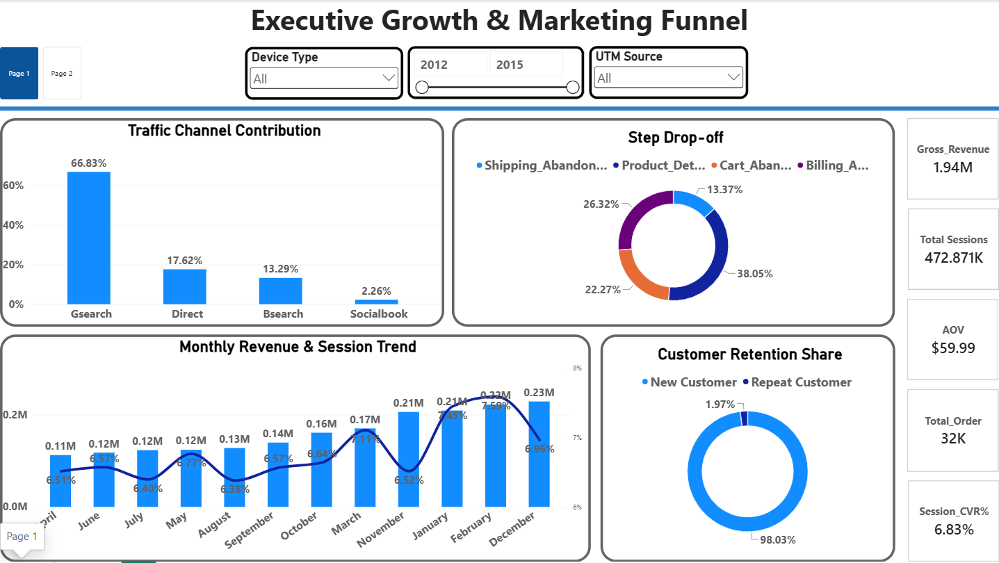
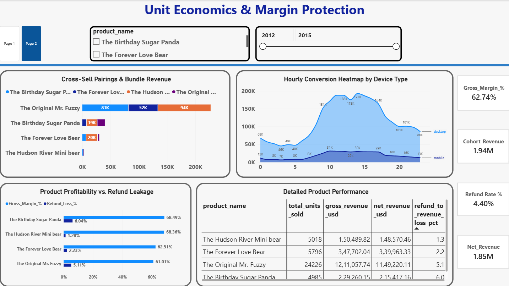

# E-Commerce-Full-Funnel-BI-Analytics
# OmniChannel E-Commerce 360: Full-Funnel BI & Revenue Leakage Engine

An end-to-end business intelligence case study connecting top-of-funnel web traffic (472K+ sessions) to bottom-line net revenue, basket cross-sell dynamics, and product return leakage.

---

## 📥 Project Deliverables & Quick Access
* **Interactive Power BI File**: [📥 Download Report (.pbix)](End-to-End%20E-Commerce%20Business%20Intelligence.pbix?raw=true)
* **SQL DDL & Mart Views**: [`DATABASE ARCHITECTURE-ECom.sql`](DATABASE%20ARCHITECTURE-ECom.sql)

---

## 📊 Executive Dashboard Previews

### Page 1: Executive Growth & Marketing Funnel
> *Focus: Acquisition channel efficiency, conversion rates (CVR), checkout abandonment, and recurring cohort mix.*

---

### Page 2: Merchandising, Unit Economics & Margin Protection
> *Focus: SKU-level gross margin, cross-sell affinity pairs, and refund leakage mitigation.*

---

## 🎯 Business Problems & Solved Inquiries

1. **Attribution & Traffic Distribution**:
   * Evaluated acquisition across `gsearch`, `bsearch`, and social campaigns to determine where marketing spend converts into buyer volume versus non-converting visits.
2. **Funnel Progression & Checkout Friction**:
   * Quantified conversion loss across a 7-step sequence (`/home` $\rightarrow$ `/products` $\rightarrow$ `/cart` $\rightarrow$ `/shipping` $\rightarrow$ `/billing` $\rightarrow$ `/thank-you`) to isolate drops between cart addition and final payment.
3. **Revenue Leakage Control**:
   * Analyzed margin erosion caused by customer returns. Identified specific products driving high top-line sales but causing outsized margin loss due to high refund rates.
4. **Market Basket Cross-Sell Dynamics**:
   * Evaluated primary-to-secondary purchase behavior to surface bundling combinations that increase Average Order Value (AOV).

---

## 🏗️ Data Architecture & Modeling

The semantic model in Power BI is built on a **Star Schema** with unidirectional `1:*` filter propagation from shared dimensions into transactional facts. Pre-computed summary marts are disconnected or linked via strict dimensions to prevent circular path errors and Cartesian joins.
